  

 

Hi, I'm Manusmita, a Computer Science student. My work centres on machine learning: building models, evaluating them, and working out why they make the predictions they do, which is what draws me to explainable AI...I also love understanding AIML theoretical concepts (working on implementing the theory 😿)

I work mainly in Python, with C (lowk) and JavaScript alongside it. For data and classical ML I use NumPy, Pandas, scikit-learn and XGBoost (one project) in Jupyter notebooks, TensorFlow for deep learning, OpenCV for computer vision, and Flask when a project needs a small web interface. My repositories here include a DSA visualizer (private rn) and my LeetCode solutions.

Right now I'm trying to build AI agents. So far, no comments 😢.

Outside of tech: baking and cats, depending on the day.

 

**Interests** &nbsp; Machine Learning &nbsp;/&nbsp; Deep Learning &nbsp;/&nbsp; Computer Vision &nbsp;/&nbsp; NLP &nbsp;/&nbsp; Explainable AI &nbsp;/&nbsp; Agentic AI

 

Languages, libraries and tools

  
  
  
  
  
  
  
  
  
  
  
  
  

 

  

 

  

  

