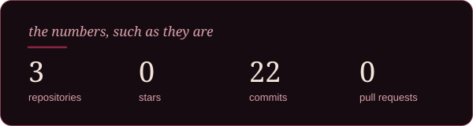

  

 

hi, i'm manusmita. i study computer science at RV University in bangalore and spend most of my time around ML: training models, then interrogating them about their choices.

currently trying to build agents...so far no comments.

outside of that: baking, cats...depending on the day.

 

**into:** &nbsp;machine learning &nbsp;/&nbsp; deep learning &nbsp;/&nbsp; computer vision &nbsp;/&nbsp; nlp &nbsp;/&nbsp; explainable ai &nbsp;/&nbsp; agentic ai

 

things i've used, not a flex

  
  
  
  
  
  
  
  
  
  
  
  
  

 

  

 

  

  

